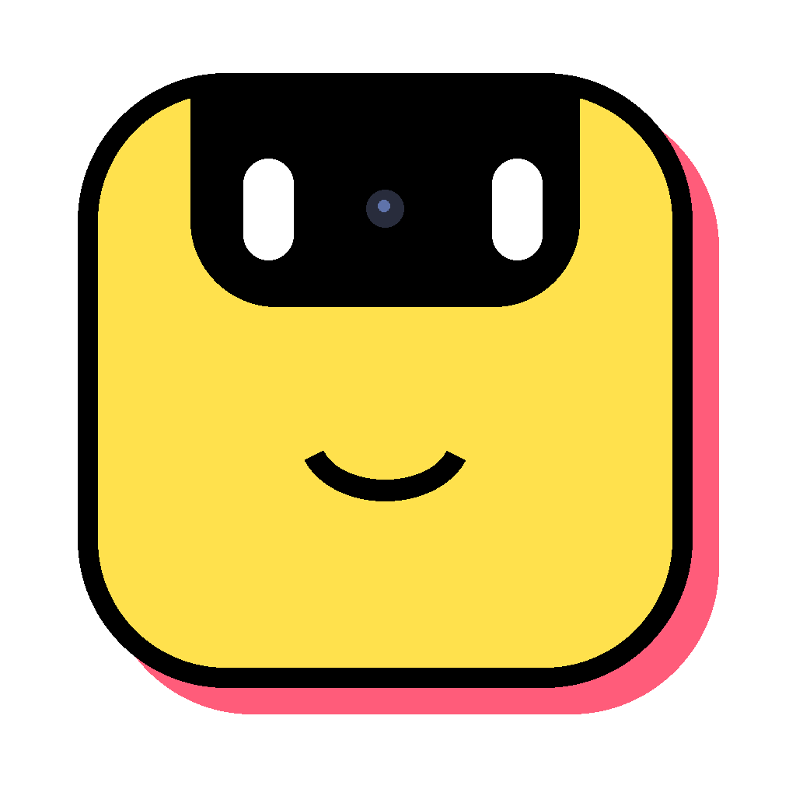

<p align="center">
  
</p>

<h1 align="center">Peeko</h1>

<p align="center">
  The free, open-source notch for your Mac, with a small friend called Pip.
</p>

<p align="center"><sub>Formerly called Perch.</sub></p>

---

Peeko turns the notch into a face. When nothing's happening, **Pip** sits either side of the
camera: two eyes that blink, follow your pointer, widen when you hover, smile when something
finishes and fall asleep at night. When something *is* happening (music, a timer, a call, a
coding assistant asking for permission) the notch stretches out and shows it: in black like
the iPhone's Dynamic Island, or in one of three other looks (Glass, Brutal, Dot Matrix).

Peeko is a fork of [Dynamic Ledge](https://github.com/shandilyaswagat/dynamic_ledge) by Swagat
Shandilya and Pritam Biswas, and keeps everything it does. New in Peeko:

- **Pip**, the notch companion (Settings › Appearance › Pip on the notch)
- **Customisable Home**: pick and order its widgets
- **Weather**, a small Weather app in the notch (⌃⌥H)
- **Lyrics** in time with the song, under the notch, and **six live music bars** that follow the real sound
- **The song colours the notch**: a glow on Black, tinted Liquid Glass, Brutal's hard shadow
- **Colour Picker** (⌃⌥X): pick any colour on screen, copy it as HEX, RGB, HSL or SwiftUI
- **Countdowns** (⌃⌥Y): days left to exams, deadlines and trips
- **Brutal** theme: graphic, like a printed poster: a crisp white outline, a solid offset plate, keys that press down
- **Dot Matrix** theme: an LED-display look with lit-dot music bars and big numbers, a faint dot grid and a scan-in when it opens
- **Stats** as its own tab beside Home: CPU per core, GPU, memory breakdown, battery health and power, network with history, the busiest apps
- **Clipboard** keeps 20, 50 or 100 copies
- **Headphone battery** when AirPods connect (Settings › Activities & Alerts)
- **Hide in full screen** and **hide from screen sharing** (Settings › General › Privacy & Focus)
- No telemetry and no updates pulled from the original app

**Build it** (needs Xcode 16 or newer, opened once to accept its licence):

```bash
BUNDLE_ID=com.sarhan.Perch Scripts/build-app.sh   # → build/Peeko.app
```

## What it does

**On its own, when something happens:**
- Music from any app, with album art, controls, lyrics and a switch for where sound plays
- Timers, counting down beside the camera
- Calls (FaceTime, Zoom, Meet, Teams, WhatsApp…) with mute and Hang Up
- Your next meeting, with a heads-up 5 minutes before
- Charging, low battery, volume and brightness
- Downloads finishing (if you turn it on)
- Allow or Deny Claude Code, Codex, Copilot CLI, Antigravity and Cursor, and a heads-up when
  they finish (if you turn it on)

**When you click it:**
- **Home** with what's live, your next event, quick timers and Shortcuts
- **Tray** for files you need again soon. Drop them on the notch, drag them out later, or AirDrop
  them. Zip them, merge PDFs and images into one PDF, or convert an image to another format
- **Clipboard** with the last 20 things you copied, and the text from images you copy (if you turn it on)
- **Notes**, a little scratchpad
- **Mirror** to check your camera before a call
- Calendar, reminders, stopwatch, Stats and Keep Awake behind the grid button

Make it small, medium or large, black or **Glass**, springy or calm, or stretch Home across the
top with **Elongated**. No notch on your Mac or second screen? You still get one, or a floating **Pill**.

## Install it

You need a Mac with macOS 14 (Sonoma) or newer and **Xcode 16 or newer** (free on the App Store).

1. Open Xcode once and click **Agree** on the licence (or run `sudo xcodebuild -license accept`).
2. Get the code and build:
   ```bash
   git clone <this repo> Peeko && cd Peeko
   BUNDLE_ID=com.sarhan.Perch APP_OUTPUT="/Applications/Peeko.app" Scripts/build-app.sh
   open /Applications/Peeko.app
   ```
3. Pip appears either side of the camera and an eyes icon appears in the menu bar.
4. Click the eyes icon › **Settings…** and turn on **Open at login** (General).

Sign it with one certificate every time (`SIGN_IDENTITY="Perch Local Signing"`, made once on your Mac), or macOS forgets permissions such as Accessibility after each rebuild.

**Permissions** are asked only when you first use the feature that needs them: Calendar
(Connect in Home), Reminders, Camera (Mirror), Accessibility (Hang Up, dragging a window into
Files) and System Audio (Live music bars). Say no and everything else keeps working.

## Use it

- **Click the notch** (or Pip) to open it. Move away, click anywhere else, or press **Esc** to close it.
- The **bar at the top** has Home, your shortcuts and what's open. **Grid** (top right) has everything.
- **⌃⌥ + a letter** opens a feature from anywhere (shown on each grid tile; ⌃⌥H is Weather).
- **Customise Home** in Settings › Home & Widgets › Home Page.
- **Grid button** (top right) opens everything else.
- **Drag files** onto the notch to drop them in Tray or AirDrop.
- **Right-click** the notch for quick controls.
- **Settings:** click the capsule icon in the menu bar, then **Settings…**

Nothing showing? That's normal. It stays hidden until there's something to show. Hover over the
notch to peek, or click it.

## Update it

Pull the latest code and run the build again. Peeko never downloads updates by itself.

## Remove it

1. If you turned on any coding assistants, switch them off in **Settings › General › Coding Assistants**
   first.
   That removes what Peeko added to their settings files.
2. Click the capsule icon in the menu bar and choose **Quit Peeko**.
3. Drag **Peeko** from Applications to the Trash.
4. To clear everything it saved too, delete these:
   - `~/Library/Application Support/Peeko`
   - `~/Library/Preferences/com.sarhan.Perch.plist`


## Privacy and permissions

**The short version:** no account, no ads, no tracking. What you do on your Mac stays on your Mac.
All the code is here, so anyone can check.

**It only goes online for:**

| What | Why | What's sent |
|---|---|---|
| GitHub | Only if you switch on update checks (off by default) | Nothing about you |
| [lrclib.net](https://lrclib.net) | Lyrics, only if Lyrics is on | The song's name, artist, album and length |
| [Open-Meteo](https://open-meteo.com) | Weather, only if Weather is on (fork) | The city you typed, then its coordinates |

No names, emails, files, clipboard, calendar or anything you type ever leave your Mac.

**Permissions** are only asked for when you first use the feature that needs them. Say no and
everything else keeps working.

| Permission | Used for | Asked when |
|---|---|---|
| Camera | Mirror. Nothing is recorded | You open Mirror |
| Calendar | Your next event | You click Connect |
| Reminders | Today's to-dos | You click Connect in Reminders |
| Accessibility | Hang Up, and dragging a document window into Tray | You first use one of them |
| Automation | Reading which file or web page a window shows, for Tray | You drag a window into Tray |
| System audio | Live music bars. The sound is only measured, never recorded or sent | You turn on Live music bars |

**What it keeps on your Mac:**
- **Clipboard:** the last 20 bits of text, in memory only. Gone when you quit, except clips you
  pin. Anything a password manager marks private is skipped. Turn Clipboard off any time.
  With **Text from images** on, a copied picture's text is read on your Mac and kept like any
  other clip; the picture itself isn't kept.
- **Tray:** links to your files, never copies. Your original files are never changed. Clears when
  you quit, except pinned items.
- **Notes and settings:** saved on your Mac only.

**Coding assistants** are off until you switch one on. Then Peeko adds a small hook to
that tool's own settings file (like `~/.claude/settings.json`) so it can ask you in the notch.
Requests stay on your Mac. Switch it off and the hook is removed.

**AI Agent Usage** is off until you switch it on. It shows how much of your Codex and Antigravity
limits you've used, with the lowest limit left beside the camera when nothing else is on. Its
launcher tile switches that and the checks off and on, like Stats. It asks the Codex app on your Mac, which checks with OpenAI using your own
Codex sign-in. For Antigravity it reads its files in `~/.gemini` and asks the Antigravity app
running on your Mac, using the local key Antigravity hands its own background service; that
request never leaves your Mac. Peeko never stores your passwords, tokens or API keys,
and sends nothing online itself.

**Music and Stats** are read from macOS on your Mac. Nothing is sent anywhere.

## Questions

**Is it safe?** Yes. It's open source, collects nothing personal, and every update is checked
before it installs. The macOS warning on first launch is only because it isn't registered with
Apple yet.

**My music isn't showing.** Play something and wait a second. If you picked **Only these apps**
in Settings › General › Now Playing, make sure your music app is ticked.

**Can I keep YouTube videos out of the notch?** Yes. Settings › General › Now Playing › **Show
music from** › **Only these apps**, and tick only your music app.

## License

Free software, © 2026 Swagat Shandilya and Pritam Biswas. Use it, share it and change it under the
[GNU GPL, version 3](LICENSE) or any later version. If you share a changed version, it has to stay
free with its source code available.
